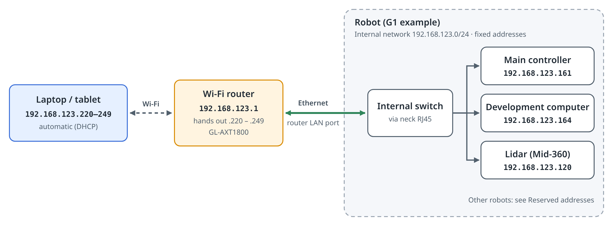
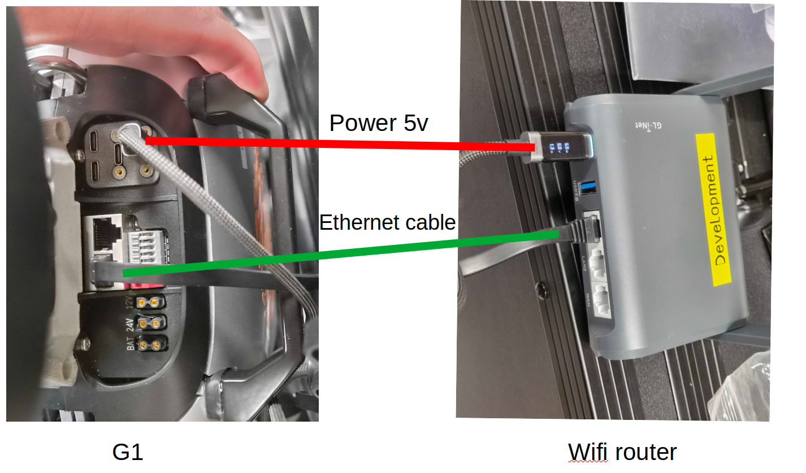
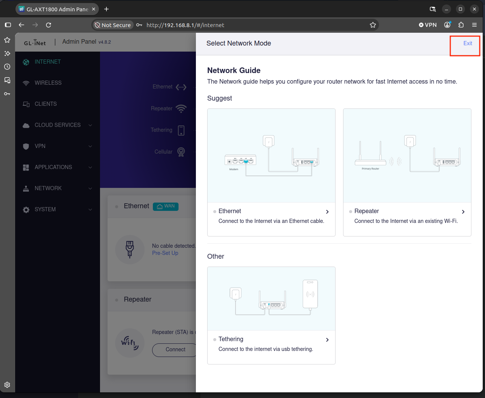
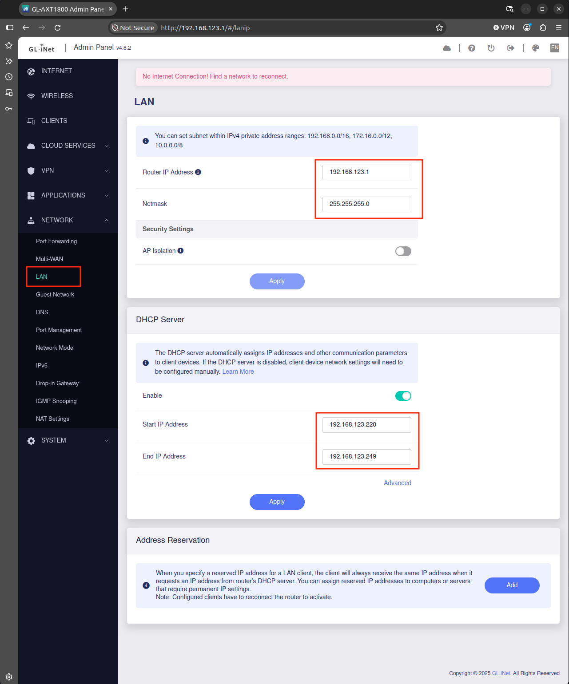
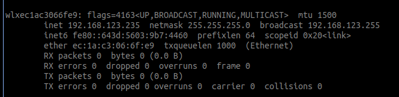

# Wi-Fi Router Setup for Unitree Robots

This guide shows how to add a Wi-Fi router to a Unitree robot, so that your laptop, tablet or other devices can reach the robot's internal computers over Wi-Fi instead of a cable.

When you finish, you will have:

- A Wi-Fi network carried by the robot.
- Every device that joins that Wi-Fi gets an address on the robot's internal network (`192.168.123.x`) automatically.
- The robot's own computers and sensors keep their fixed addresses and keep working exactly as before.

The router only extends the robot's internal network over Wi-Fi. It does not connect the robot to the internet.

**Time needed:** about 30 minutes.

**Router used in this guide:** GL.iNet GL-AXT1800 (Slate AX), firmware v4.8.2.

## How it works

Unitree robots use a private wired network inside the robot, `192.168.123.0/24`. Each internal device (main controller, development computer, lidar) has a fixed address on it. The router joins this same network and hands out addresses to Wi-Fi devices from a range that no internal device uses.

[](./img/router-network-diagram.png)

| Address | Device | Set by |
|---------|--------|--------|
| `192.168.123.1` | Wi-Fi router | You, in this guide |
| `192.168.123.220` – `192.168.123.249` | Laptops, tablets and other Wi-Fi devices | Router (automatic) |
| Fixed addresses (see [Reserved addresses](#reserved-addresses)) | Robot's internal computers and sensors | Unitree, do not change |

## Before you start

### What you need

| Item | Notes |
|------|-------|
| Wi-Fi router | This guide uses the GL.iNet GL-AXT1800. Other routers are set up the same way, but their menu names may differ. |
| Ethernet cable (RJ45) | From a LAN port on the router to the robot's Ethernet port. |
| USB-C to USB-C cable | Powers the router from the robot. The router needs 5 V / 4 A; see [Step 1: Connect power](#step-1-connect-power). |
| Laptop | With an Ethernet port (or a USB-to-Ethernet adapter) and a web browser. |

:::warning

Power off the robot before you plug anything into it.

:::

### Reserved addresses

Each robot's internal computers and sensors use fixed addresses on `192.168.123.x`; see the robot's Unitree developer documentation for the list. The range used in this guide, `.220`–`.249`, does not clash with them. Never give the router or another device an address that the robot already uses.

:::info

Some robots also have a second internal network (`192.168.124.x`). This router does not reach it.

:::

:::tip

Unitree's guides tell you to set your computer to a fixed address such as `192.168.123.222` when you use a cable. When you connect over this router's Wi-Fi, set your computer back to **automatic (DHCP)** instead.

:::

## Part 1: Hardware

The router needs two cables to the robot: one for power and one for the network. On a G1 both go to the neck panel.

[](./img/g1-router-connections.png)

| Cable | Robot side (G1 neck panel) | Router side (GL-AXT1800) |
|-------|----------------------------|--------------------------|
| Power (red) | USB-C port, 5 V | USB-C power port |
| Ethernet (green) | RJ45 port | **LAN** port (not WAN) |

### Step 1: Connect power

The GL-AXT1800 needs **5 V / 4 A** through its USB-C power port.

| Robot | Accessory power outputs |
|-------|-------------------------|
| G1 / G1-D | USB-C 5 V / 1.5 A (×3), 12 V / 5 A, 24 V / 5 A |

:::warning

The G1's USB-C ports are rated 1.5 A, less than the router's rating. In our test the router ran normally from one G1 USB-C port, but this is not guaranteed for every robot or workload. If the router restarts by itself, use a DC-DC converter as described below.

:::

Connect a USB-C to USB-C cable from a USB-C port on the G1's neck panel to the router's USB-C power port.

See the red line in the [connection photo](#part-1-hardware).

:::warning

Never connect the router directly to a 12 V or 24 V output. It needs 5 V.

:::

**If the router restarts or loses power:** power it from the robot's 12 V or 24 V accessory output through a DC-DC step-down (buck) converter:

- **Input:** matches the output you use (12 V or 24 V).
- **Output:** 5 V, **at least 4 A**, with a USB-C connector to the router's power port.
- Measure the converter's output with a multimeter before you connect the router.

:::info

The G1's 12 V and 24 V outputs are each rated 5 A, so either can supply a 5 V / 4 A converter (about 20 W) with margin.

:::

### Step 2: Connect the Ethernet cable

Connect a **LAN** port on the router to the robot's Ethernet port. On a G1 this is the RJ45 port on the neck panel.

:::warning

Use a **LAN** port on the router, not the **WAN** port. On the WAN port the router treats the robot as the internet and the robot network will not be reachable.

:::

See the green line in the [connection photo](#part-1-hardware).

## Part 2: Router configuration

Do this part on a desk, with the router connected only to your laptop, **before** connecting the router to the robot. A new router uses its own factory network (`192.168.8.x` on GL.iNet), and connecting it to the robot before it is configured can cause address conflicts.

### Step 1: Connect your laptop to the router

1. Power on the router and wait about 1 minute.
2. Connect your laptop to a **LAN** port of the router with an Ethernet cable.
3. Make sure your laptop gets its address automatically (DHCP). This is the default on most laptops.
4. Open a web browser and go to `http://192.168.8.1`.

### Step 2: First-time setup

The first two screens ask you to choose the language and set an **admin password**, then to set the **Wi-Fi name and password**. Fill them in and continue.

:::tip

Record the admin password somewhere safe. You need it every time you change the router settings.

:::

### Step 3: Exit the Network Guide

After the first-time setup, the router opens the **Select Network Mode** guide. This guide connects the router to the internet, which is not needed here.

Select **Exit** in the top-right corner.

[](./img/glinet-network-guide-exit.png)

### Step 4: Change the router's address and Wi-Fi address range

Go to **NETWORK → LAN**. The page has two boxes, **LAN** and **DHCP Server**, and each box has its own **Apply** button.

[](./img/glinet-lan-dhcp.png)

1. In the **DHCP Server** box, set the following and select that box's **Apply**:
   - **Enable:** On
   - **Start IP Address:** `192.168.123.220`
   - **End IP Address:** `192.168.123.249`
2. In the **LAN** box, set the following and select that box's **Apply**:
   - **Router IP Address:** `192.168.123.1`
   - **Netmask:** `255.255.255.0`
   - **AP Isolation:** Off. If it is on, Wi-Fi devices cannot reach each other.

Leave **Address Reservation** empty.

:::info

After you apply the new router address, the router moves to it and the browser page stops responding. This is expected. The red "No Internet Connection" banner at the top of the page is also expected, because this router is not connected to the internet.

:::

Then reconnect:

1. Unplug the Ethernet cable from your laptop and plug it back in, so the laptop gets a new address.
2. Check that your laptop now has an address between `192.168.123.220` and `192.168.123.249`.
   - **Windows:** open Command Prompt and run `ipconfig`.
   - **Ubuntu:** open a terminal and run `ip -br addr`.
   - **macOS:** System Settings → Network → your Ethernet connection.
3. Open `http://192.168.123.1` in the browser and log in with the admin password.

Example on Ubuntu: the laptop got `192.168.123.235`, which is inside the range.

[](./img/laptop-address-ubuntu.png)

## Part 3: Connect to the robot and verify

1. Power off the router and the robot.
2. Connect the router to the robot as described in [Part 1](#part-1-hardware).
3. Power on the robot.
4. On your laptop, join the robot's Wi-Fi network.
5. Check that your laptop has an address between `192.168.123.220` and `192.168.123.249`.
6. Check that you can reach the robot. For a G1:

   ```bash
   ping -c 3 192.168.123.1      # router
   ping -c 3 192.168.123.161    # main controller
   ping -c 3 192.168.123.164    # development computer
   ping -c 3 192.168.123.120    # lidar
   ```

   Expected: every line ends with `0% packet loss`. For other robots, ping the main controller and development computer addresses from the robot's Unitree documentation.

7. Log in to the development computer:

   ```bash
   ssh unitree@192.168.123.164
   ```

:::tip

If all of the above work, the router is set up correctly.

:::

## Troubleshooting

| Symptom | Likely cause | Fix |
|---------|--------------|-----|
| Laptop gets an address that is not `192.168.123.x` | Router settings were not saved, or the laptop is still on another network | Log in to the router again and check NETWORK → LAN. Disconnect other networks on the laptop |
| Laptop gets `169.254.x.x` | No DHCP answer from the router | Check the cable, check DHCP is enabled, restart the router |
| Laptop keeps an old address outside `.220`–`.249` (e.g. `.222` set by hand, or a leftover from before the change) | Manual address, or an old lease | Set the laptop's network to automatic (DHCP), then unplug and replug the cable or reconnect the Wi-Fi |
| Router page reachable but robot does not answer `ping` | Cable in the router's WAN port, or loose cable | Move the cable to a LAN port; reseat both ends |
| Robot answers sometimes, drops out at random | Two devices share one address | Make sure no device uses the router address or the `.220`–`.249` range; see [Reserved addresses](#reserved-addresses) |
| Robot answers `ping`, but `http://192.168.123.1` does not open | The router's web page failed to start | Restart the router. If the page still does not open, factory reset it (hold the reset button for about 10 s) and repeat [Part 2](#part-2-router-configuration) |
| Router restarts by itself | Not enough power from the robot's USB-C port | Power it through a 5 V / 4 A DC-DC converter; see [Step 1: Connect power](#step-1-connect-power) |
| Forgot the admin password | — | Factory reset: hold the reset button for about 10 s, then restart from [Part 2](#part-2-router-configuration) |

## Do's and don'ts

**Do**

- Configure the router on a desk first, then connect it to the robot.
- Keep a record of the admin password.

**Don't**

- Don't change any address inside the robot (main controller, development computer, lidar).
- Don't give the router an address the robot already uses (see [Reserved addresses](#reserved-addresses)).
- Don't connect a second router or DHCP server to the robot network.
- Don't plug the robot into the router's WAN port.
