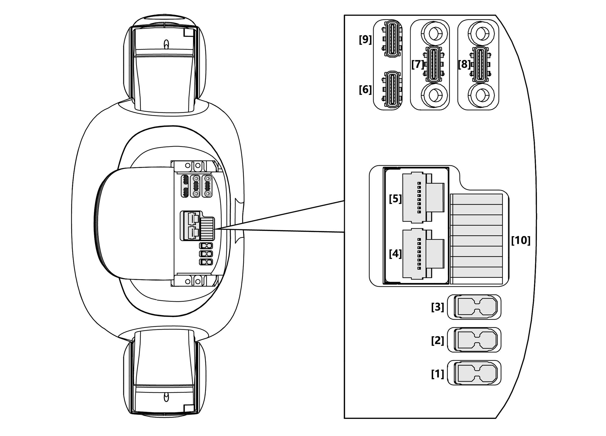
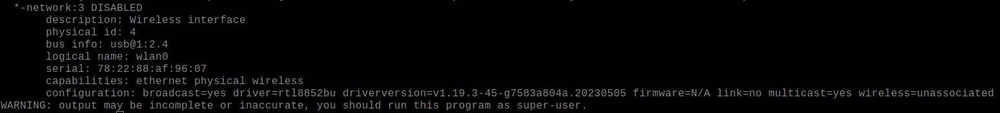
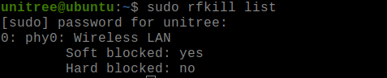

# G1 Internet Access Guide

This guide details 2 methods to provide the internal development PC (192.168.123.164) internet access.
The first method utilises the WiFi card onboard the internal development PC to connect to a WiFi Access Point with internet access.
The second method configures a host computer to connect to the internal development PC using a static IP over Ethernet and share internet access from the host.

## Method 1: Connect Internal Development PC to WiFi

1. Connect to the internal development PC via LAN using **port 4 or 5** on the G1 electrical interface.
[](./img/dev_pc_hw_interface.jpg)

2. ssh into the internal development PC
```bash
ssh unitree@192.168.123.164
Password: 123
```

3. Show Network Devices
```bash
lshw -C network
```
[](./img/lshw.png)

4. Check Wi-Fi Block Status
```bash
sudo rfkill list
```
[](./img/rfkill_list.png)

If Wi-Fi is blocked, unblock it:
```bash
sudo rfkill unblock wlan
```
5. Enable WiFi
```bash
sudo nmcli radio wifi on
```
6. Connect to a WiFi Network
```bash
sudo nmcli device wifi connect <SSID> password <password>
```
7. Test
```bash
ping 8.8.8.8
```
If the ping fails with `Destination Host Unreachable` from `192.168.123.164`, see [WiFi Connected but No Internet](#wifi-connected-but-no-internet).

### WiFi Connected but No Internet

The development PC can join the WiFi network and still have no internet access, even when other devices on the same network do. The symptoms:

* `nmcli dev status` shows `wlan0` as `connected`.
* `ping 8.8.8.8` fails with `Destination Host Unreachable`, and each line reads `From 192.168.123.164`. That is the `eth0` address on the robot's internal network, not the WiFi address.
* `ping google.com` fails with `Temporary failure in name resolution`.

Check the routing table:
```bash
ip route
```
If it lists two `default` routes, the one with the lower `metric` carries all internet traffic. Output from an affected robot:
```
default via 192.168.123.1 dev eth0 proto static metric 20100
default via 192.168.0.1 dev wlan0 proto dhcp metric 20600
```
Here the `eth0` route wins, so internet traffic is sent to `192.168.123.1` on the robot's internal network. The robot has no router on that network (see [Network Configuration](/guides/unitree/g1_dev_guide#network-configuration)), so the traffic goes nowhere.

1. Confirm the cause. Delete the `eth0` default route and test again:
```bash
sudo ip route del default via 192.168.123.1 dev eth0
ping -c3 8.8.8.8
ping -c3 google.com
```
If both pings succeed, the `eth0` default route was the cause. This change is not saved, so the route returns when the robot restarts.

2. Fix it permanently. Find the connection on `eth0` in the `CONNECTION` column of `nmcli dev status` (`unitree1` on the robot above), then stop NetworkManager from giving that connection a default route. Replace `unitree1` with your connection name:
```bash
sudo nmcli con mod unitree1 ipv4.never-default yes
sudo nmcli con up unitree1
ip route
```
`ip route` should now list one `default` route, via `wlan0`. `eth0` keeps its address (`192.168.123.164`) and its `192.168.123.0/24` route, so the development PC still reaches the rest of the robot.

:::warning
`nmcli con up` re-activates the `eth0` connection, which can briefly interrupt the robot's internal network. Run it while no program on the development PC is commanding the robot.
:::

## Method 2: Network Sharing Between Host and Internal Development PC

Connect to the internal development PC via a USB-hub using **port 9** on the G1 electrical interface.
[](./img/dev_pc_hw_interface.jpg)

### Step 1: Configure Static IP on Robot (Internal Development PC)

Create a Netplan config file
```bash
sudo vim /etc/netplan/01-network-manager-all.yaml
```
Paste the following into the file:
```bash
network:
  version: 2
  renderer: NetworkManager
  ethernets:
    eth0:  # replace with the unassigned ethernet interface
      dhcp4: no
      addresses: [192.168.1.2/24]
      gateway4: 192.168.1.1   # This IP address corresponds to the host's static IP, to be created in step 2
      nameservers:
        addresses: [8.8.8.8, 8.8.4.4]
```
***Note**: The internal development PC has 2 ethernet interfaces (eth0 and eth1). One of the interfaces will already be assigned an IP of 192.168.123.164. **Please do not configure this interface in the netplan config file, instead use the UNASSIGNED interface.***

Test the Netplan configuration
```bash
sudo netplan try
```
Press the "Enter" key when prompted.

Verify the default gateway on the internal computer
```bash
ip route
```
The expected output:
```bash
default via 192.168.1.1 dev eth0 proto static metric 101
```

### Step 2: Configure Static IP on Host (Your Computer)

Assign a static IP to your host’s Ethernet interface that is in the same subnet, e.g., 192.168.1.1.\
**The IP address must follow the gateway address set in the netplan config file in step 1.**
```bash
sudo nmcli con modify <ethernet_interface_name> ipv4.addresses 192.168.1.1/24
sudo nmcli con modify <ethernet_interface_name> ipv4.method manual
sudo nmcli con up <ethernet_interface_name>
```
###  Step 3: Enable Internet Sharing on the Host

1. Verify the internet-connected interface on host computer
```bash
ip route get 8.8.8.8
```
The expected output should be similar to:
```bash
8.8.8.8 via 192.168.29.1 dev wlp0s20f3 src 192.168.29.179 uid 1000
```

For this sample setup, we'll use the interfaces below. Please change the interfaces according to your host computer.

Ethernet to robot is: enx34298f73882f

Internet interface is the interface identified in step 3.1: wlp0s20f3 (WiFi) or enp0s31f6 (LAN)

2. Enable IP Forwarding
Check if enabled:
```bash
cat /proc/sys/net/ipv4/ip_forward
```
If it returns 0, enable it:
```bash
echo "1" > /proc/sys/net/ipv4/ip_forward
```
3. Set Up NAT and Forwarding Rules
```bash
# Replace wlp0s20f3 with your actual internet interface
# Replace enx34298f73882f with your robot ethernet interface

sudo iptables --table nat --append POSTROUTING --out-interface wlp0s20f3 -j MASQUERADE
sudo iptables --append FORWARD --in-interface enx34298f73882f --out-interface wlp0s20f3 -j ACCEPT
sudo iptables --append FORWARD --in-interface wlp0s20f3 --out-interface enx34298f73882f -m state --state RELATED,ESTABLISHED -j ACCEPT
```
4. Verify the NAT Rule Exists
```bash
sudo iptables -t nat -L -n -v
```
*Look for a MASQUERADE rule under POSTROUTING.*

### Step 4: Test the Connection

#### On the robot (internal computer):
1. Check IP address:
```bash
ifconfig
```
2. Ping the host computer:
```bash
ping 192.168.1.1
```
3. Try pinging a public IP:
```bash
ping 8.8.8.8
```