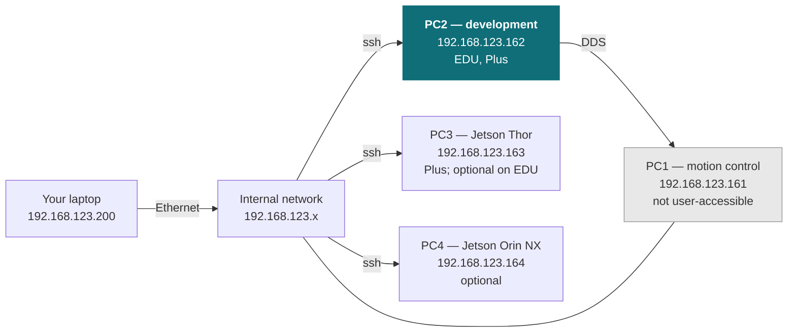

# H2

<Split ratio="wide-narrow">

<div>

Unitree's H2 full-size humanoid, supplied as a development platform. Unitree's control stack handles balance and locomotion; you write your application against it over the robot's internal network, wired for anything touching low-level control.

This page does not repeat or replace Unitree's documentation. It highlights the information you reach for most often, and supplements it with what we have learned from supplying and supporting these units — configuration, verified values, and our own guides.

Unitree's own documentation:

* [Official product page](https://www.unitree.com/H2)
* [H2 Plus product page](https://www.unitree.com/H2plus)
* [Official documentation](https://support.unitree.com/home/en/H2_developer)

</div>

<Figure
  src={require('../img/unitree/H2_robot.png').default}
  alt="Unitree H2 full-size humanoid robot"
  size="hero" />

</Split>

:::caution Preliminary

The values on this page come from Unitree's published documentation and robot models, and have not yet all been confirmed on the units we supply. Where Unitree's own pages disagree with each other, this page says so.

:::

{/* Internal: ported from wr_unitree_support docs/robots/h2.md while it was still [~] (source-audited, not hardware-verified), as an agreed exception to PUBLISHING.md. Keep the page unlisted until that page is [x], then drop the caution above. */}

## Getting started

Read [Operational Safety](/guides/operational-safety) before powering the robot for the first time, including the [additional hazards specific to humanoids](/guides/safety/humanoids). The H2 is a full-size bipedal robot of about 70 kg: it can fall, and at that size it can do real damage to itself and its surroundings when it does. Follow the guidance there on supporting it during early testing.

Only **H2 EDU** and **H2 Plus** run your own code. The base H2 has only the motion control computer, which is not open to users — see [Variants](#variants).

Bring-up in outline:

1. **Power on** and pair the remote controller. Unitree covers start-up, shut-down and remote binding in the Quick Start videos in its [developer documentation](https://support.unitree.com/home/en/H2_developer).
2. **Connect your machine** to the robot's internal network over Ethernet — see [Network layout](#network-layout).
3. **SSH to the development computer** — see [Logins and IP addresses](#logins-and-ip-addresses).
4. **Install the SDK** and run one of Unitree's H2 examples to confirm the chain works. Joint-level control needs [debug mode](#before-low-level-control-debug-mode) first.

## Key information

A quick reference for the things you reach for most often, collected so you can find them with the robot in front of you.

### Related resources

Files and repositories you clone or download to work with the robot.

| Resource | What it is | Where |
| --- | --- | --- |
| User manual | Unitree's H2 user manual | [H2 user manual](https://marketing.unitree.com/article/en/H2/User_Manual.html) |
| Developer documentation | Unitree's H2 documentation | [H2 developer](https://support.unitree.com/home/en/H2_developer) |
| C++ SDK | Primary development interface (same repo as G1 and R1); H2 examples in `example/h2/` | [unitree_sdk2](https://github.com/unitreerobotics/unitree_sdk2) |
| Python SDK | Python bindings for the same interface; H2 examples in `example/h2/` | [unitree_sdk2_python](https://github.com/unitreerobotics/unitree_sdk2_python) |
| ROS 2 package | ROS 2 integration; H2 examples in `example/src/src/h2/` (the README does not list H2) | [unitree_ros2](https://github.com/unitreerobotics/unitree_ros2) |
| URDF | Robot model for simulation and mechanical design — not in `unitree_model`, which has H2 as USD only | [unitree_ros — h2_description](https://github.com/unitreerobotics/unitree_ros/tree/master/robots/h2_description) ([H2 Plus with Sharpa hands](https://github.com/unitreerobotics/unitree_ros/tree/master/robots/h2_plus)) |
| MuJoCo model | Simulation model, used by Unitree's C++ simulator | [unitree_mujoco — h2](https://github.com/unitreerobotics/unitree_mujoco/tree/main/unitree_robots/h2) |

Installing Weston Robot packages on the robot or your host? Add our package repository first: [Weston Robot Apt Source](/guides/installation/apt_source).

Vendor manuals, videos and the mobile app are on the official pages linked at the top of this page.

### Variants

All three variants share the same 31-DOF body, battery and joint motors. They differ in compute, cameras and whether you can run your own code.

| | H2 | H2 EDU | H2 Plus |
| --- | --- | --- | --- |
| Secondary development (your own code) | No | Yes | Yes |
| PC1 — motion control (Intel Core i5) | Yes | Yes | Yes |
| PC2 — development (Intel Core i7) | — | Yes | Yes |
| PC3 — Jetson Thor T5000 | — | Optional | Yes |
| PC4 — Jetson Orin NX 16 GB | — | Optional | Not stated by Unitree |
| Head camera | Binocular, on PC1 | Binocular, on PC1 | Binocular, GMSL2 to PC3 |
| Wrist cameras | — | — (GMSL cameras can be added with PC3) | Optional |
| Dexterous hands | — | Optional | Optional |

### Specifications

| Item | Value |
| --- | --- |
| Dimensions, standing (H × W × T) | 1820 × 456 × 218 mm |
| Weight (with battery) | ~70 kg |
| Total DOF | 31 — 6 per leg, 3 waist, 7 per arm, 2 head |
| Max joint torque | Leg 360 N·m; arm 120 N·m |
| Arm payload | Rated ~7 kg; peak ~15 kg |
| Leg length (thigh + calf) | 1045 mm |
| Arm length (upper arm + forearm) | 690 mm |
| Battery | Quick-release smart battery, 15 Ah (0.972 kWh), 75.6 V max; ~3 h runtime |
| Audio | 4-microphone array; 8 Ω 10 W speaker (12 W peak); RGB light strip |
| Connectivity | Gigabit Ethernet, WiFi 6, Bluetooth 5.2 |
| Cooling | Local air cooling |

Joint limits, per joint, from Unitree's MuJoCo model (`h2_mujoco.xml`; the H2 URDF has the same position and effort limits). Left and right are mirrored; the values shown are the left side.

| Joint | Range (rad) | Effort limit |
| --- | --- | --- |
| Hip pitch | −2.45 to 2.78 | 360 N·m |
| Hip roll | −0.47 to 2.17 | 360 N·m |
| Hip yaw | ±2.83 | 360 N·m |
| Knee | −0.09 to 2.53 | 360 N·m |
| Ankle roll | −0.35 to 0.30 | 19 N·m |
| Ankle pitch | −1.13 to 0.61 | 66.88 N·m |
| Waist yaw | ±1.75 | 120 N·m |
| Waist roll | ±0.52 | 180 N·m |
| Waist pitch | −0.44 to 0.52 | 180 N·m |
| Shoulder pitch | −2.62 to 1.83 | 130 N·m |
| Shoulder roll | −0.52 to 2.49 | 60 N·m |
| Shoulder yaw | ±2.62 | 60 N·m |
| Elbow | −0.99 to 3.07 | 60 N·m |
| Wrist roll | ±2.62 | 60 N·m |
| Wrist pitch | ±0.58 | 10 N·m |
| Wrist yaw | ±1.22 | 10 N·m |
| Head pitch | −0.52 to 0.84 | 50 N·m |
| Head yaw | ±1.75 | 50 N·m |

> Unitree's spec table gives 120 N·m for the arm joints; the model gives the shoulder pitch 130 N·m.

The ankles and the waist roll and pitch are parallel linkages driven by two motors each. In the SDK the ankle order is roll before pitch, the reverse of the G1, so G1 low-level code does not carry over unchanged.

### Head camera

| | H2 / H2 EDU | H2 Plus |
| --- | --- | --- |
| Interface | MIPI CSI-2, to PC1 | GMSL2, to PC3 |
| Resolution | 2064 × 1552 | 2560 × 1984 |
| Frame rate | 30 FPS | 30 FPS |
| Shutter | Global | Global |
| Baseline | 60 mm | 60 mm |
| HFOV / VFOV | 156° / 116° | 140° / 102° |
| Depth of field | 0.15 m to infinity | 0.4 m to infinity |
| How you get images | Over the network, from PC1's streaming services | As raw frames on PC3, after loading the camera driver |

On H2 and H2 EDU the camera is wired to PC1, which is not open to users, so you receive its images as network streams rather than raw frames. On H2 Plus you read the frames on PC3 yourself; the camera driver is tied to the JetPack version and is loaded again after every boot. Unitree's developer documentation covers both paths.

### Logins and IP addresses

| Computer | Address | Credentials | What it is | Fitted on |
| --- | --- | --- | --- | --- |
| PC1 — motion control | `192.168.123.161` | — | Unitree's locomotion stack. Not user-accessible | All variants |
| **PC2 — development** | `192.168.123.162`, `192.168.124.162` | `unitree` / `Unitree0408` | Intel x86 — where your code runs | EDU, Plus |
| PC3 — Jetson Thor | `192.168.123.163`, `192.168.124.163` | `unitree` / `123` | AI compute; hosts the GMSL cameras on Plus | Plus; optional on EDU |
| PC4 — Jetson Orin NX | `192.168.123.164`, `192.168.124.164` | `unitree` / `123` | AI compute | Optional |

You reach the development computers over SSH and talk to PC1 from there over DDS — you do not log into PC1 directly.

> Unitree gives `Unitree#24226` as the PC2 password on early firmware, and one of its pages gives `123`. If `Unitree0408` is refused, try those.

Use a **wired** connection for anything touching low-level control — WiFi dropouts can stall a control loop and drop the robot. WiFi is reasonable for high-level work and for internet access.

{/* TODO: confirm on a unit whether H2 Plus has PC4, and the PC2 operating system (wr_unitree_support TODO.md). */}

### Network layout

The robot has two internal subnets, `192.168.123.x` and `192.168.124.x`, each with its own Gigabit Ethernet port. The development computers answer on both; PC1 is on `192.168.123.x` only. **Your code goes on PC2** (or on PC3 / PC4 where fitted).



Plug into the Ethernet port on the `192.168.123.x` subnet, set your host machine to a static IP on that subnet (e.g. `192.168.123.200/24`), then:

```bash
ping 192.168.123.161   # PC1 — replies once the robot has booted
ping 192.168.123.162   # PC2, development

ssh unitree@192.168.123.162
```

Pass your host's network interface name (from `ip a`) to each SDK example: `--network_interface=enp3s0` for `h2_loco_client`, which otherwise uses loopback (`lo`) and reaches nothing, or as the first argument for the low-level examples.

{/* TODO: Unitree's pages and our pre-delivery check place the Ethernet ports on the top, rear, shoulder and neck. Confirm on a unit and say where the .123 port is. */}

### Electrical interfaces

All on the robot's interface panel, shown in the electrical interfaces figure in Unitree's developer documentation.

| Group | What's there |
| --- | --- |
| Power outputs | Battery-voltage, 24 V and 12 V outputs on GXT30 connectors, for external accessories; each also carries RS-485 or CAN |
| USB | Several USB 3.0 Type-C ports, some with DisplayPort and power delivery |
| Video | One GMSL input, usable only when PC3 is fitted |
| Network | Two Gigabit Ethernet ports, one on each subnet — see [Network layout](#network-layout) |
| Dexterous hands | Two hand connectors carrying power, plus RS-485 and USB or Ethernet depending on the hand |

:::caution Before you plug in

- **Which computer a USB port reaches depends on what is fitted.** With PC3 or PC4 installed, some Type-C ports move from PC2 to the Jetson, so a device you expect on PC2 can appear on PC3 or PC4 instead. Check Unitree's port table for your configuration.
- **All accessory outputs share one total power budget**, apart from the direct battery output.
- **Some RS-485 buses are shared** between a hand connector and a power connector when the hands are set up for RS-485.
- **The Wuji hand2 takes 12 V, from port [10].** Unitree warns that 24 V damages it.

:::

Unitree's H2 Plus spec table lists more GMSL and Ethernet ports than its interface figure shows. Check what is fitted on your unit.

For exact port numbers, pin assignments and full specifications, see Unitree's [official H2 developer documentation](https://support.unitree.com/home/en/H2_developer).

### Before low-level control: debug mode

The motion program on PC1 starts at power-on and keeps commanding the joints, so joint-level SDK control needs debug mode first:

1. Put the robot in damping (**L2 + B**) and hang it on its protective stand, with the stand's four casters locked.
2. Press **L2 + R2** to enter debug mode.
3. Press **L2 + A**. The robot performs a short diagnostic action, which shows debug mode is on.

In debug mode the remote does not control the robot. Stop your program with **Ctrl+C**.

{/* TODO: how to leave debug mode is not described on Unitree's H2 pages. */}

### Emergency stop

This is what [Operational Safety](/guides/operational-safety#if-something-goes-wrong) means by "hit the emergency stop" on the H2.

| If… | Do this | Result |
| --- | --- | --- |
| Normal operation | Press and hold **L2 + B** | Damping — joints go limp |
| Your program is controlling the joints (debug mode) | Stop the program with **Ctrl+C** | The remote does not control the robot in this mode |

> Before cutting power: make sure the robot is hanging on its stand, seated, or lying down — a standing H2 collapses the instant power is cut, and at ~70 kg it falls hard.

{/* TODO: hardware E-stop, force-shutdown sequence, and whether the latest remote's E-Stop button applies to H2. */}

### Safety notes

- **Keep well clear during any powered motion**, with the remote in hand. Leg joints deliver up to 360 N·m.
- **Run new low-level code against the MuJoCo model first.** Taking over joint-level control hands you all 31 joints at once; a mistake drops the whole robot.
- **Unitree publishes no IP rating for the H2.** Treat it as not waterproof.

### What we supply

We have supplied H2 EDU and H2 Plus. The H2 Plus units we have supplied carry two wrist cameras, which vary by unit between GMSL cameras and USB cameras on PC3; `v4l2-ctl --list-devices` on PC3 shows which.

{/* TODO: fitted sensors, hands, and anything else that differs from a unit bought direct from Unitree. Serial number and model designation location. */}

## Troubleshooting & FAQ

### Can I run my own code on the base H2?

No. Only H2 EDU and H2 Plus support secondary development. The base H2 has only PC1, which is not open to users. See [Variants](#variants).

### Can I develop over WiFi instead of a wired connection?

For high-level work, yes. **Not for low-level control** — a WiFi latency spike or dropout can stall the control loop, and the H2 can lose balance and fall as a result. Use a cable for anything joint-level or balance-related.

See [the full answer](/guides/operational-safety#while-you-are-developing).

### Questions that apply across our platforms

These are answered in the guides rather than repeated on every product page:

- [Is the robot waterproof?](/guides/operational-safety#where-you-can-operate) — and what the ratings mean across platforms
- [How often do I need to lubricate the joints?](/guides/maintenance/humanoids) — and what to do about stiffness or play
- [The robot has fallen over and does not respond to the controller](/guides/operational-safety#if-something-goes-wrong) — the recovery sequence

## Support

Collect the serial number, firmware version and logs before raising a ticket — [Before you contact us](/support/before-you-contact-us) lists what helps and includes the commands to gather it.

[Submit a support request](https://forms.office.com/r/qELKzYF33W).
