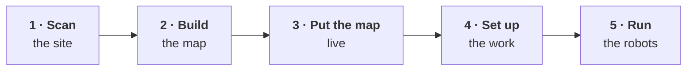

# Quick start

This page covers a whole deployment, from scanning the site to robots running their missions. Each stage gives who does it, the steps in order, what to expect, and how you know it is done. Every step links to the page that covers it in full.

| Stage | Who | Done when |
| --- | --- | --- |
| [1 · Scan the site](#1--scan-the-site) | Whoever captures the site | You have the exported `.pcd`, below 200 MB |
| [2 · Build the map](#2--build-the-map) | Anyone can author it. Pushing needs an Admin | The site has a new draft revision |
| [3 · Put the map live](#3--put-the-map-live) | Admin. An Operator can catch a robot up | Each robot runs the activated map, is localised, and reaches the points you send it to |
| [4 · Set up the work](#4--set-up-the-work) | Admin. An Operator can set run conditions and send missions | Each mission's badge reads **robot confirmed** |
| [5 · Run the robots](#5--run-the-robots) | Operator | Ongoing |

*Admin* on this page means a **Site Admin** for that site or a **Tenant Administrator**. [Roles](/solution/robot-management-toolbox/tenant-management#roles) defines every role.

## Before you start

- **Weston Robot sets up your tenant, sites and robots.** We provision the sites, register the robots, and deliver each robot with its network configured. [Contact us](/support/before-you-contact-us) to add a site or a robot.
- **Someone needs to be an Admin at the site.** Pushing, publishing and activating a map all need it. A Tenant Administrator [creates users and grants roles](/solution/robot-management-toolbox/tenant-management#creating-users-and-granting-roles).
- **Use a desktop or laptop browser.** Both toolboxes are built for it, and the Robot Deployment Toolbox expects a mouse.
- **Read the safety guides before anyone works near a moving robot:** [Operational Safety](/guides/operational-safety) and [Quadruped safety](/guides/safety/quadrupeds).

## 1 · Scan the site

**Who:** Whoever captures the site. No role in the Robot Management Toolbox is needed.  
**You need:** A charged [Pocket2](/peripheral/sensor/manifold_pocket2), a phone running MindCloud Go, a desktop running MindCloud Studio with its per-machine licence, and a USB 3.0 data cable. [What you need](/guides/manifold#what-you-need)  
**Full guide:** [Manifold Scanner Guides](/guides/manifold)

1. **Before the visit:** charge the scanner, install both apps, and get the MindCloud Studio licence.
2. **Connect:** join the phone to the scanner's own Wi-Fi, then turn on **Connect Device** in MindCloud Go. [Connection](/guides/manifold/connecting)
3. **Start:** tap **Start Scan**, name the project, and set the NTRIP and Panorama toggles if required. They cannot be turned on once the scan is running. [Creating the project](/guides/manifold/scanning#creating-the-project)
4. **Initialise:** set the scanner down flat and level, and leave it alone until the point cloud appears. [Initialisation](/guides/manifold/scanning#initialisation)

   <Figure
     src={require('../guides/manifold/img/mindcloud-go-scan-initialising.jpg').default}
     alt="The MindCloud Go Scan Job screen during initialisation, showing a blue Waiting for device initialization banner, a telemetry panel reading Scan Duration 00:00:02, Translation 0.0 metres per second, Rotation 0.0 degrees per second, Total Distance 0.0 metres and Point Count 0, with device temperature and free storage in a strip along the top"
     size="sm"
     framed
     caption="Still initialising: the blue banner is showing and Point Count is 0. Pick the scanner up once the banner clears and the preview fills with points." />

5. **Walk the site** at a controlled pace, on a route that crosses back over itself. [Walking the site](/guides/manifold/scanning#walking-the-site)
6. **Stop:** check the preview for gaps, tap stop, and wait for *Project saved as …*. [Stopping](/guides/manifold/scanning#stopping-is-the-step-that-commits-the-data)
7. **Copy and load:** copy the whole project folder off the scanner over rear **Port C**, and load the `.lx` in MindCloud Studio with **File ▸ New Task**. [Processing](/guides/manifold/processing#getting-the-capture-from-the-scanner)
8. **Export:** check the cloud, apply **Subsample ▸ Spatial ▸ 0.1 m**, then export it as **Point Cloud Library cloud (`*.pcd`)** in **Binary**, named `pointcloud_map.pcd`. [Exporting the `.pcd`](/guides/manifold/processing#exporting-the-pcd)

**What to expect**

- **The scan is recorded on the scanner, not on the phone.** While the phone is on the scanner's Wi-Fi it has no internet, and only one phone can connect at a time.
- **Losing the phone does not stop the scan, and only the phone that started it can stop it.** Rejoin the Wi-Fi with that phone, then stop.
- **Processing is slow and CPU-heavy.** Run it on a computer you can leave busy.
- **Re-scan while you are still on site** if the preview looks tilted, warped or doubled, has sections floating apart, or has gaps where you walked. [Judging a scan](/guides/manifold/scanning#judging-a-scan-before-you-leave)

:::tip Done when

You have `pointcloud_map.pcd`, exported in Binary and below 200 MB, from a cloud you
[checked in MindCloud Studio](/guides/manifold/processing#look-at-it-before-you-export).

:::

## 2 · Build the map

**Who:** Anyone can author a map, because it stays in their browser. Importing a site's map needs **Observer** or above at that site. Pushing needs an **Admin**.  
**Where:** The [Map editor](/solution/robot-deployment-toolbox/map-editor) in the Robot Deployment Toolbox.

1. **Load:** choose **Start from local files** and load `pointcloud_map.pcd`. If the site already has a map, use **Import from Fleet** instead. [Load Map Data](/solution/robot-deployment-toolbox/map-editor#1--load-map-data)
2. **Prepare:** downsample the cloud, gravity-align it so the floor sits flat, and crop what the map does not need. [Prepare Data](/solution/robot-deployment-toolbox/map-editor#2--prepare-data)
3. **Levels:** run **Extract** and add the plane that is the floor, or use **+ Manual** if it is not listed. Then generate its occupancy map at about robot height. [Setup Levels](/solution/robot-deployment-toolbox/map-editor#3--setup-levels)
4. **Edit:** place nodes (waypoints, and a charging node where the robot charges), join them with segments, and draw zones where the robot must not go. Give the nodes names. [Edit Map](/solution/robot-deployment-toolbox/map-editor#4--edit-map)
5. **Check routes:** in the [Map inspector](/solution/robot-deployment-toolbox/map-inspector), test that the routes that matter can be solved. [Testing that a route solves](/solution/robot-deployment-toolbox/map-inspector#testing-that-a-route-solves)
6. **Export and push:** read the validation warnings, write the changelog, then push to the fleet. Choose the site, add the revision to the existing map if the site has one, and write a change summary that says what changed. [Export](/solution/robot-deployment-toolbox/map-editor#5--export) · [Pushing to the fleet](/solution/robot-deployment-toolbox/map-editor#pushing-to-the-fleet)

**What to expect**

- **Your work is saved in the browser, but the point cloud is not.** When you reopen a map later, you load the cloud again. [Reopening a map](/solution/robot-deployment-toolbox#reopening-a-map-requires-loading-the-point-cloud-again)
- **Keep the whole bundle below 300 MB.** It goes over Wi-Fi to every robot that works the site.
- **Clean validation means the map is consistent with itself.** It does not mean the map matches the building. Only driving a robot on it, in stage 3, shows that.
- **More than one detected level does not mean more than one floor.** The supported model is one deployment level on one physical floor. [Floors and elevations](/solution/robot-deployment-toolbox#can-a-deployment-span-different-floors-or-elevations)
- **A push does not change anything on a robot.** It creates a draft revision, and robots keep their current map until that revision is published and activated.

:::tip Done when

The push succeeds, and the site has a new **draft** revision in the Robot Management Toolbox.

:::

## 3 · Put the map live

**Who:** An **Admin** publishes, activates and assigns maps. Catching a robot up can also be done by an **Operator**.  
**Where:** The Robot Management Toolbox, on the site's own page. [A site's maps](/solution/robot-management-toolbox/tenant-management#a-sites-maps)

1. **Publish, then activate:** under the site's **Maps**, choose **Publish** on the draft revision, then **Activate**. The confirmation lists the robots on that map. [How a map reaches a robot](/solution/robot-management-toolbox/tenant-management#how-a-map-reaches-a-robot)
2. **Assign the map to each robot:** in the site's **Robots** list, **Assign Map** sets which map a robot runs. [How a robot is assigned a map](/solution/robot-management-toolbox/tenant-management#how-a-robot-is-assigned-a-map)
3. **Catch each robot up:** choose **Take control & update** on the robot's own view. An Admin can also choose **Approve apply** from **Map status** in the site's Robots list. Wait for the robot to confirm the new map. If the update fails, retry it from the same place. [Catching a robot up to the map](/solution/robot-management-toolbox/tenant-management#catching-a-robot-up-to-the-map)

   <Figure
     src={require('./img/fleet-map-update.png').default}
     alt="A dialog headed 'Dev-B2 · map', comparing what the fleet has activated — map Meeting Room, revision r1 and a bundle identifier — with what is on the robot: map blk55_office_level3, revision r8 and a bundle identifier. Between them a status line reads 'not on this robot yet'. A warning says navigation restarts and re-acquires localization, and that the robot's missions are switched off and need checking and switching back on. Close and Approve apply buttons sit at the bottom"
     size="lg"
     framed
     caption="The map comparison, opened from Map status: what the fleet activated, and what is on the robot. Approve apply starts the update." />

4. **Check that it is localised:** the navigation map's header should read **Localized**, and the robot should show as a blue arrow where it really is, pointing the way it faces. If the header reads **Not Localized**, use **Init Pose**: click where the robot really is and drag the way it faces, as closely as you can judge. A see-through green arrow shows the pose while you drag. Once the robot takes it, the blue arrow moves there. [The panels](/solution/robot-management-toolbox/robot-dashboard#the-panels)

   <Figure
     src={require('./img/fleet-robot-marker.png').default}
     alt="A close view of the navigation map: the robot drawn as a blue arrow with a white outline, pointing up and to the left, beside a green marker labelled Home, among the map's blue nodes, segments and corridor labels"
     size="md"
     framed
     caption="The robot is the blue arrow, pointing the way it faces." />

5. **Test it by driving:** send the robot to a few points across the site with [Quick Dispatch](/solution/robot-management-toolbox/mission-editing#quick-dispatch), and watch it arrive at each one. [The map is validated by driving on it](/solution/robot-deployment-toolbox/map-editor#the-map-is-validated-by-driving-on-it)

**What to expect**

- **One Admin can take a map from draft to live.** If your process needs a second person to approve a map, that check has to happen outside the system.
- **Updating a robot's map restarts its navigation.** The robot has to localise again before it can work, so do not update a robot in the middle of a task.
- **A robot that is behind cannot be dispatched.** Its missions are switched off, and dispatch and Go Home are unavailable until it confirms the new map. **downloaded, not applied** means it is still running the old map.
- **A robot that already has saved locations cannot be given work until an Admin confirms each one against the new map.** A robot with no saved locations yet has nothing to confirm. [After a map change](/solution/robot-management-toolbox/mission-editing#after-a-map-change)
- **After each Quick Dispatch, the robot takes no new work until you acknowledge the result.** [Recovery and acknowledgement](/solution/robot-management-toolbox/robot-dashboard#recovery-and-acknowledgement)
- **The first activation on a new site is a test, not a delivery.** If the robot cannot localise, drifts off segments or fails to reach nodes, go back to stage 2. If the scan itself is the problem, go back to stage 1.

:::tip Done when

Each robot runs the activated revision, reads **Localized**, and reaches the points you send it to.

:::

## 4 · Set up the work

**Who:** Saved locations and missions need an **Admin**. Run conditions and sending can also be done by an **Operator**.  
**Where:** The Robot Management Toolbox. [Mission editing and dispatch](/solution/robot-management-toolbox/mission-editing)

1. **Save the places** the work uses, and set each robot's **home**: choose **Set Home** on the control panel and click the map, or choose **Set home** on a saved location. [Saved locations](/solution/robot-management-toolbox/mission-editing#saved-locations)
2. **Build each mission** in the Mission Editor: name it, choose patrol or errand, then add checkpoints and the actions at each one. [The editor](/solution/robot-management-toolbox/mission-editing#the-editor)
3. **Give each mission a run condition.** A mission without one cannot be activated or sent. [Run conditions](/solution/robot-management-toolbox/mission-editing#run-conditions)
4. **Activate the mission, then choose Send to Robot,** and check that the badge reads **robot confirmed**. [Sending missions to a robot](/solution/robot-management-toolbox/mission-editing#sending-missions-to-a-robot)
5. **Give your team their roles.** This needs a Tenant Administrator. [Creating users and granting roles](/solution/robot-management-toolbox/tenant-management#creating-users-and-granting-roles)

**What to expect**

- **An active mission is not necessarily on the robot.** Activating makes a mission eligible to run, and **Send to Robot** puts it on the robot. To see what the robot has, read the badge rather than the activation.
- **Times are in the robot's local time**, not the browser's.
- **Moving a saved location does not update a robot that already holds the mission.** The mission is badged **location changed** until you choose **Send to Robot** again.

:::tip Done when

Every mission each robot should run is **Active**, and its badge reads **robot confirmed**.

:::

## 5 · Run the robots

**Who:** An **Operator**. An Observer can watch, and can use the E-Stop.  
**Where:** The **Dashboard** in the Robot Management Toolbox, then each robot's own view. [Robot dashboard](/solution/robot-management-toolbox/robot-dashboard)

1. **Open the Dashboard** and look for anything that needs attention.
2. **Open the robot** in question.
3. **Let the schedule run, or start something yourself:** run a saved mission now with **Dispatch**, or send the robot to one point with **Quick Dispatch**.
4. **Watch it**, and use **Go Home** or the **E-Stop** if you need to step in.
5. **When a run fails, acknowledge it,** then check that auto-dispatch is running again. [Recovery and acknowledgement](/solution/robot-management-toolbox/robot-dashboard#recovery-and-acknowledgement)
6. **Review what the robots found.** [Detection review](/solution/robot-management-toolbox/detection-review)

**What to expect**

- **Only one person can command a robot at a time,** because commanding it means holding its controls. The E-Stop is the exception: anyone with a role at the site can press it, and an Operator resets it. [Taking control](/solution/robot-management-toolbox/robot-dashboard#taking-control)
- **After Go Home, watch where the robot is, not what the panel says.** The panel can still say the work is staged while the robot is already driving home.
- **After a failed run, the robot takes no new work until you acknowledge it.** A failed scheduled mission also does not restart its schedule by itself.
- **If the robot loses its link to the fleet,** you lose the live view and cannot send commands. What the robot does then is set when Weston Robot commissions it. [What happens during a mission](/solution/robot-management-toolbox/robot-dashboard#what-happens-during-a-mission)

**When something is not right**

| You see | What to check |
| --- | --- |
| A robot is idle when it should be working | **Resume Auto-Dispatch**: auto-dispatch may be paused. [Auto-dispatch](/solution/robot-management-toolbox/robot-dashboard#auto-dispatch) |
| Dispatch and Go Home are unavailable | The robot is behind the activated map. [Catching a robot up](/solution/robot-management-toolbox/tenant-management#catching-a-robot-up-to-the-map) |
| **This robot's map changed** on the robot's view | Its saved locations need an Admin to confirm them. [After a map change](/solution/robot-management-toolbox/mission-editing#after-a-map-change) |
| **Not Localized** in the navigation map's header | **Init Pose**. [The panels](/solution/robot-management-toolbox/robot-dashboard#the-panels) |
| **Go Home** reads **Set Home** | No home is set for this robot. [Saved locations](/solution/robot-management-toolbox/mission-editing#saved-locations) |
| A mission badge ends in **· needs review** | The map has changed under the mission, so check the mission against the map now activated. [Sending missions to a robot](/solution/robot-management-toolbox/mission-editing#sending-missions-to-a-robot) |
| An action is refused | [When an action cannot proceed](/solution/robot-management-toolbox/mission-editing#when-an-action-cannot-proceed) |

## When the site changes

You come back to the map when the building changes: racking is added, a wall is moved, or a door is closed for good.

**If only a saved location has moved,** an Admin moves the location in the Robot Management Toolbox, and no new map is needed. Then choose **Send to Robot** for each mission badged **location changed**. [Saved locations](/solution/robot-management-toolbox/mission-editing#saved-locations)

**If the building has changed:**

1. **Import from Fleet** in the Map editor, rather than reusing an old copy, and make the change. Only one person should edit a site's map at a time, because neither would see the other's changes. If the scan no longer matches the building, scan again, then load the new cloud together with the existing map under **Start from local files**. [Load Map Data](/solution/robot-deployment-toolbox/map-editor#1--load-map-data)
2. **Push the revision to the existing map,** so the site keeps one history, with a change summary that says what moved. [What the push asks for](/solution/robot-deployment-toolbox/map-editor#what-the-push-asks-for)
3. **Publish it, then activate it at a time when the robots can stop and restart their navigation.** You can push as soon as the work is done. [What activation costs a robot](/solution/robot-deployment-toolbox/map-editor#what-activation-costs-a-robot)
4. **Catch each robot up.** [Catching a robot up to the map](/solution/robot-management-toolbox/tenant-management#catching-a-robot-up-to-the-map)
5. **Confirm its saved locations:** an Admin chooses **Confirm pose** on each one, or moves it to where it belongs. Until every location is confirmed, the robot cannot be given work. [After a map change](/solution/robot-management-toolbox/mission-editing#after-a-map-change)
6. **Switch its missions back on,** and check that each badge reads **robot confirmed**. [Sending missions to a robot](/solution/robot-management-toolbox/mission-editing#sending-missions-to-a-robot)

## Support

Before raising a ticket, note which stage you were at, which site is involved, and which robot or map. [Before you contact us](/support/before-you-contact-us) lists what helps.
